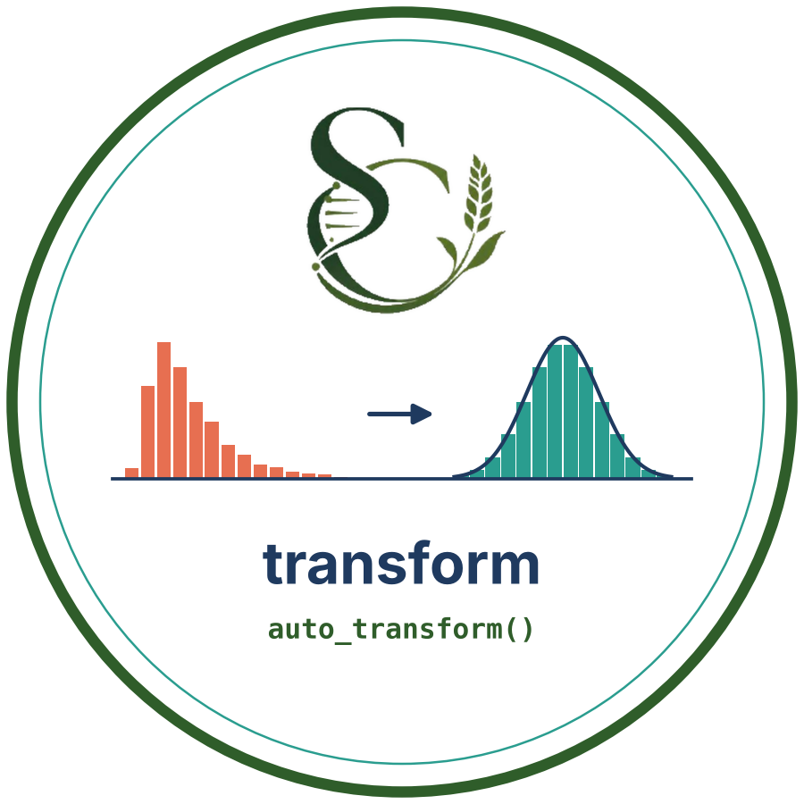

# transform
### Automatic Normalizing Transformations for R

<p align="center">
  
</p>

<p align="center">

[](https://opensource.org/licenses/MIT)
[]()
[]()
[]()

</p>

---

`transform` tests a numeric vector for normality and, if the data are not normal,
tries several transformations, picks the one that gets closest to a normal
distribution, and lets you reverse it back to the original scale.

It is built for biological, agricultural, soil, water and environmental data
(for example **pH, yield, concentrations, counts**), where skewed values, zeros
and negative numbers are common.

---

# Features

✅ One function: `auto_transform(x)`  
✅ Normality test first: Shapiro-Wilk (n ≤ 5000) or D'Agostino-Pearson (n > 5000)  
✅ Already normal? Data are returned unchanged, with a message  
✅ Five candidate transformations compared automatically  
✅ Handles zeros and negative values (shifted log/sqrt, Yeo-Johnson, rank-based)  
✅ Missing values (`NA`) kept in place  
✅ Clear errors for non-numeric, constant or infinite input  
✅ `print()`, `plot()`, `predict()` and `inverse_transform()` methods  

---

# Installation

```r
# Install remotes if needed
install.packages("remotes")

# Install from GitHub
remotes::install_github("chapagainsujan/transform")
```

---

# Quick Start

```r
library(transform)

set.seed(1)
x <- rlnorm(200)          # right-skewed example data

res <- auto_transform(x)  # test, compare, choose
res                       # summary and candidate table
plot(res)                 # before / after diagnostics
inverse_transform(res)    # back to the original scale
```

<p align="center">
  
</p>

*Illustration of the before/after diagnostics produced by `plot(res)`.*

---

# How it works

```text
numeric vector
   │
   ├─ Normality test ── p > alpha ──► return original data ("none")
   │
   └─ p ≤ alpha
        │
        ├─ log          log(x), or log(x + c) if x ≤ 0
        ├─ sqrt         sqrt(x), or sqrt(x + c) if x < 0
        ├─ Box-Cox      maximum-likelihood lambda (x > 0 only)
        ├─ Yeo-Johnson  maximum-likelihood lambda (any values)
        └─ Rank INT     rank-based inverse normal (Blom)
                │
                ▼
   Pick the candidate with the best normality statistic
   (Shapiro-Wilk W, or lowest K² for n > 5000).
   If nothing improves on the original data, the original is returned.
```

---

# Main Function

```r
auto_transform(x, alpha = 0.05, method = "auto")
```

| Argument | Description |
|---|---|
| `x` | Numeric vector. `NA` values are removed for fitting and kept as `NA` in the output |
| `alpha` | Significance level for the normality test (default `0.05`) |
| `method` | `"auto"` (default), `"log"`, `"sqrt"`, `"boxcox"`, `"yeojohnson"` or `"int"` |

---

# Available Functions

| Function | Description |
|---|---|
| `auto_transform()` | Test, compare and apply the best transformation |
| `print()` | Summary of original vs transformed normality and the candidate table |
| `plot()` | 2 × 2 panel: histogram and Q-Q plot, before and after |
| `inverse_transform()` | Convert transformed values back to the original scale |
| `predict()` | Apply the fitted transformation to new data, or invert with `inverse = TRUE` |

---

# Returned Object

`auto_transform()` returns an object of class `"auto_transform"`:

| Element | Description |
|---|---|
| `transformed_data` | The transformed vector (same length as the input) |
| `method_used` | Chosen method, or `"none"` if the data were already normal |
| `lambda` | Box-Cox / Yeo-Johnson parameter (otherwise `NA`) |
| `shift` | Constant added for log / sqrt (otherwise `NA`) |
| `original_p_value` | Normality-test p-value before transformation |
| `final_p_value` | Normality-test p-value after transformation |
| `original_data` | The original vector, kept for inversion |
| `candidates` | Table comparing every method tried |

---

# Examples

## Skewed data

```r
x <- rlnorm(200)
res <- auto_transform(x)
res$method_used
res$final_p_value
```

## Data with zeros and negative values

```r
y <- rexp(200) - 1
auto_transform(y)
```

## Data that are already normal

```r
auto_transform(rnorm(100))
#> Data are already normally distributed ... returning the original data.
```

## Choose the method yourself

```r
auto_transform(x, method = "yeojohnson")
auto_transform(x, method = "boxcox")
```

## Reverse the transformation

```r
res <- auto_transform(x)
back <- inverse_transform(res)
all.equal(back, x)
```

## Apply the same transformation to new values

```r
predict(res, newdata = c(0.5, 1, 2))
```

---

# Transform a column from an Excel file

```r
install.packages(c("readxl", "writexl"))

library(readxl)
library(writexl)
library(transform)

dat <- read_excel("AA.xlsx")

res <- auto_transform(dat$pH)
res
plot(res)

dat$pH_transformed <- res$transformed_data
write_xlsx(dat, "AA_transformed.xlsx")
```

---

# Good to know

- **Rank-based INT** usually gets the best normality statistic, but it cannot be
  reversed smoothly for values outside the observed range. Use `method = "boxcox"`,
  `"yeojohnson"` or `"log"` if you need a reusable formula.
- **Regression and ANOVA** assume normal *residuals*, not a normal raw column.
  Check the residuals of your model before deciding a transformation is needed.
- **Box-Cox** needs strictly positive data. It is skipped automatically in
  `"auto"` mode when the data contain zeros or negatives.
- Large samples (n > 5000) use the D'Agostino-Pearson test because
  `shapiro.test()` is limited to 5000 values.

---

# Repository Structure

```text
transform/
├── DESCRIPTION
├── NAMESPACE
├── LICENSE
├── LICENSE.md
├── README.md
├── logo.png
├── example.png
├── R/
│   ├── auto_transform.R
│   ├── methods.R
│   └── utils.R
├── man/
└── tests/
    ├── testthat.R
    └── testthat/
        └── test-auto_transform.R
```

---

# Testing

```r
devtools::test()
#> [ FAIL 0 | WARN 0 | SKIP 0 | PASS 52 ]
```

---

# Citation

```bibtex
@software{transform2026,
  title  = {transform: Automatic Normalizing Transformations},
  author = {Sujan Chapagain},
  year   = {2026},
  url    = {https://github.com/chapagainsujan/transform}
}
```

---

# Contributing

Contributions are welcome.

1. Fork the repository
2. Create a feature branch

```bash
git checkout -b feature/amazing-feature
```

3. Commit changes

```bash
git commit -m "Add amazing feature"
```

4. Push to GitHub

```bash
git push origin feature/amazing-feature
```

5. Open a Pull Request

---

# Issues & Support

Please report bugs or request features here:

[GitHub Issues](https://github.com/chapagainsujan/transform/issues)

---

# License

This project is licensed under the **MIT License**.

---

<p align="center">
  Made for researchers who need their data to behave.
</p>
